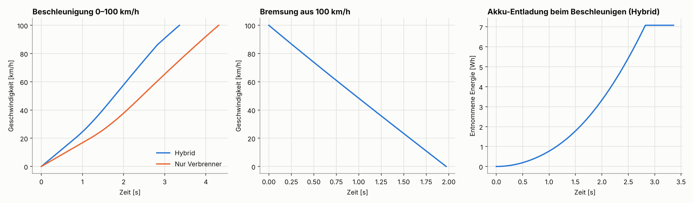

# Hybrid-Kart-Sim

Eine Python-Simulation der Längsdynamik eines Hybrid-Karts mit Verbrennungsmotor an der Hinterachse und Elektromotor an der Vorderachse.



## Ziel

Mein Ziel war es, ein mögliches Hyperkart (mein Konzept eines straßenlegalen Mini-Karts) mit möglichst physikalisch realistischen Werten zu simulieren. Die Simulation soll zeigen, wie schnell es beschleunigt, wie es bremst und wie sich dabei der Akku entlädt und wieder auflädt. Dafür habe ich Schritt für Schritt ein eigenes Simulationsmodell aufgebaut.

## Was bisher umgesetzt ist

- Fahrzeugdaten (Gewicht, Achslast, Reifen, Luftwiderstand usw.) in [fahrzeug.py](fahrzeug.py)
- Beschleunigungs- und Ausrollsimulation mit Luft- und Rollwiderstand sowie Traktionsgrenze
- Getriebe mit Gangwechsel und Zugkraftunterbrechung beim Schalten
- Drehmomentkurve des Verbrennungsmotors
- Drei Hybrid-Modi: voll elektrisch unterstützt, Hybrid und nur Verbrenner
- Akkusystem: E-Boost entlädt den Akku, beim Bremsen wird Energie rekuperiert
- Tests mit pytest in [test_sim.py](test_sim.py)

## Ausführen

```bash
python sim.py                    # Simulation starten und Diagramme anzeigen
python -m pytest test_sim.py     # Tests ausführen
```

Benötigt: `numpy`, `matplotlib`, `pytest`

## Hinweis zur Entstehung

Die Logik dieses Projekts stammt größtenteils von mir selbst. KI habe ich nur an ein paar Stellen genutzt, um Fehler zu finden (Debugging).

## Hinweis zu den Fahrzeugdaten

Mehrere Werte in [fahrzeug.py](fahrzeug.py), zum Beispiel die Drehmomentkurve, wurden mithilfe von KI geschätzt. Die Ergebnisse sind deshalb Näherungen. Die Berechnungen selbst stimmen und werden durch Tests (Energiebilanz, Grenzfälle) abgesichert. Für eine realistischere Simulation kann man die Fahrzeugwerte in [fahrzeug.py](fahrzeug.py) jederzeit durch echte Daten ersetzen.

## Status

Das Projekt ist **pausiert**. Wegen Schule und Zeitmangel arbeite ich gerade nicht daran weiter, möchte es aber eventuell später wieder aufnehmen.
